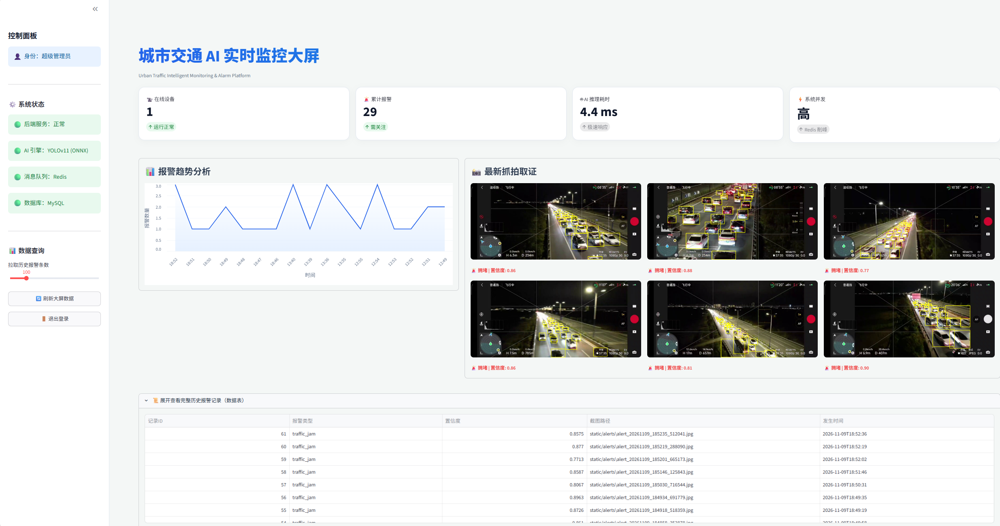
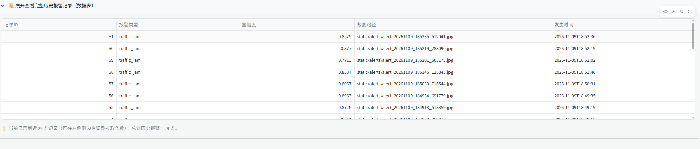
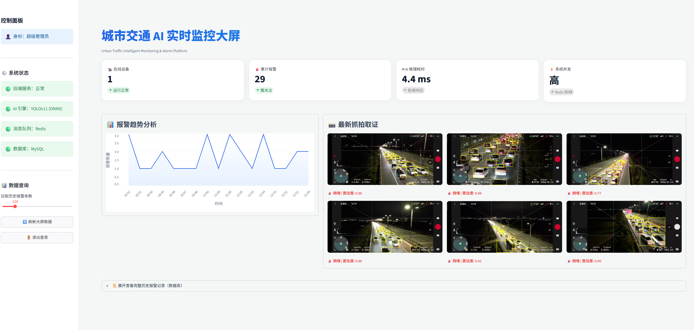
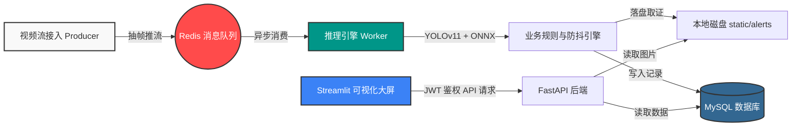
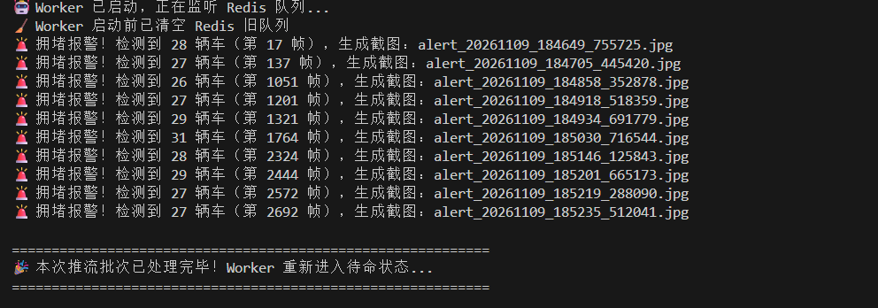
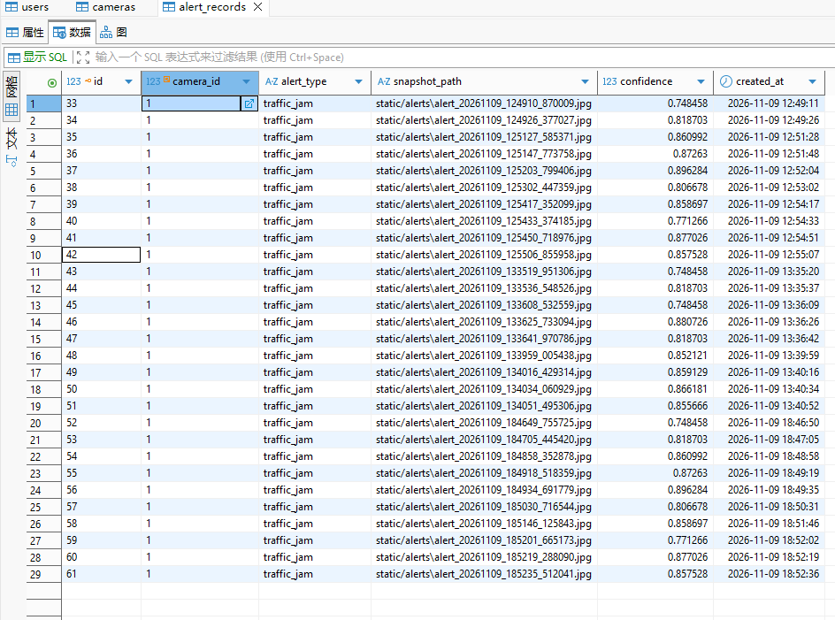

# 🚦 城市交通 AI 实时监控与告警平台 (Urban Traffic Monitor)


## 📌 项目背景与业务价值

在智慧城市建设中，交通拥堵和违规事件的及时发现是核心痛点。传统的监控系统依赖人工盯防，效率低下。

本项目是一个**高并发、全栈闭环的 AI 视觉实战项目**。系统从底层模型微调、轻量化部署，到后端的异步消息队列处理，再到前端的高级可视化大屏，实现了**“视频流接入 -> AI 异步推理 -> 业务规则防抖 -> 告警取证落库 -> 实时大屏展示”**的完整落地闭环。

## 📸 效果展示 (Demo)

| 1. 现代化监控大屏 (支持登录/数据动态刷新) | 2. 历史告警多维度分析与取证列表 |
| :---: | :---: |
|  |  |
| **核心功能**：JWT 鉴权登录，实时统计、折线图渲染、抓拍墙展示 | **核心功能**：动态拉取历史记录，图表联动，图片留存验证 |

| 3. AI 实时抓拍与防抖取证 (Redis 削峰) |
| :---: |
|  |
| **核心逻辑**：模型在夜间/航拍视角下精准框出车辆，触发阈值后截图并写入 MySQL |

## 🏗️ 系统架构设计 (System Architecture)

本项目采用了 **“生产者-消费者 (Producer-Consumer)”** 的高并发架构，彻底解决了视频流推拉与深度学习推理速度不匹配的问题。



## ✨ 核心技术栈与落地成果

### 1. 算法侧：高难度目标检测与推理优化
*   **技术栈**：`YOLOv11s`、`PyTorch`、`ONNX`、`ONNX Runtime`。
*   **落地成果**：基于 VisDrone 高空航拍高密度小目标数据集进行微调，克服了目标像素极小、极易漏检的难题。将模型导出为 **ONNX 格式**，脱离庞大的 PyTorch 依赖，实测在纯 CPU 环境下单帧端到端推理耗时仅 **4.4 ms**，完美适配无 GPU 的边缘设备。

### 2. 架构侧：基于 Redis 的异步队列与背压策略
*   **技术栈**：`Redis`、多线程。
*   **落地成果**：采用**生产者-消费者**模式。Producer 持续抽取 RTSP 视频帧推入 Redis 队列，Worker 独立消费并进行推理，实现**推流与推理解耦**。针对极限并发场景，引入 **`LTRIM` 丢帧保新策略**，当队列积压超阈值时自动丢弃旧帧，确保报警的绝对实时性，防止 OOM 崩溃。

### 3. 业务侧：精细化规则引擎与防告警风暴
*   **技术栈**：`Python`、空间逻辑判定、时间/帧数双重阈值。
*   **落地成果**：抛弃单帧直接报警的粗暴逻辑，实现基于数量阈值的业务判定（如检测到货车/小汽车总数 > 25 辆触发拥堵告警）。同时，加入**“时间 + 逻辑帧”双重防抖机制**，避免同一拥堵事件在短时间内重复截图上万次，极大地保护了数据库与磁盘性能。

### 4. 后端侧：规范的 API 开发与安全鉴权
*   **技术栈**：`FastAPI`、`SQLAlchemy`、`MySQL`、`JWT`、`Bcrypt`。
*   **落地成果**：搭建规范的后端架构，实现无状态登录与 JWT 鉴权。用户的密码使用 Bcrypt 进行加盐哈希存储，绝不明文落库。利用 FastAPI 依赖注入（`Depends`）实现了严格的接口拦截与权限控制，支持设备列表、告警记录的分页查询。

### 5. 前端侧：数据驱动的可视化大屏
*   **技术栈**：`Streamlit`、`Pandas`、`Altair`。
*   **落地成果**：纯 Python 构建现代化大屏，实现了极简亮色风格的 UI 设计。前端完全通过 RESTful API 携带 Token 与后端通信。集成 `Altair` 渲染动态报警趋势面积图，支持海量历史报警记录的滑块分页拉取，并实现了图片取证墙的实时刷新渲染。

---

### 🔍 运行状态与技术细节证明 (点击展开)

<details>
<summary>🖥️ 点击查看：终端多进程并发运行状态 (Producer & Worker)</summary>
<br>

<p><i>说明：Worker 正在实时消费 Redis 队列，终端持续输出基于业务防抖机制生成的告警日志。</i></p>
</details>

<details>
<summary>🗄️ 点击查看：MySQL 数据库告警落库记录</summary>
<br>

<p><i>说明：通过 SQLAlchemy 写入的报警记录，包含告警类型、置信度、截图路径及时间戳。</i></p>
</details>

---

## 📂 项目工程结构

```text
Urban-Traffic-Intelligent-Monitoring & Alarm-Platform/
│
├── backend/                # 后端服务核心
│   ├── api/                # 路由层 (auth登录, cameras设备, alerts报警)
│   ├── core/               # 核心配置与 JWT 安全 (config, security)
│   ├── models/             # SQLAlchemy 数据库模型定义
│   ├── database.py         # MySQL 与 Redis 连接池管理
│   └── main.py             # FastAPI 启动入口
│
├── core/                   # 算法推理核心
│   └── detector.py         # ONNX 推理引擎封装与 NMS 后处理
│
├── models/                 # 模型仓库
│   └── best.onnx           # 微调并导出的轻量化部署模型
│
├── static/alerts/          # 运行时自动生成的违规截图存放处
│
├── visdrone2yolo.py        # 数据工程：VisDrone 数据集转换为 YOLO 格式并划分
├── train.py                # 模型训练：YOLOv11 微调训练脚本
├── export_onnx.py          # 模型转换：将 .pt 导出为 ONNX 格式
│
├── dashboard.py            # Streamlit 可视化大屏前端
├── producer.py             # 视频流模拟推流引擎 (生产者)
├── worker.py               # 异步推理与报警规则引擎 (消费者)
├── init_db.py              # 一键建表与初始化管理员脚本
└── requirements.txt        # 环境依赖清单
```

## 🚀 快速启动指南 (Quick Start)

### 1. 环境准备
确保本地已启动 **MySQL** 和 **Redis** 服务。
```bash
# 克隆项目并安装依赖
git clone https://github.com/l1-lpf/Urban-Traffic-Intelligent-Monitoring-Alarm-Platform.git
cd Urban-Traffic-Intelligent-Monitoring-Alarm-Platform
pip install -r requirements.txt
```

### 2. 数据库初始化
执行建表脚本，并在 MySQL 中自动创建默认管理员账号 (`admin` / `123456`)：
```bash
python init_db.py
```

### 3. 启动多进程服务
请分别打开三个终端，运行以下命令：

**终端 1：启动后端 API**
```bash
uvicorn backend.main:app --reload --port 8000
```

**终端 2：启动 AI 推理 Worker**
```bash
python worker.py
```

**终端 3：启动可视化大屏**
```bash
streamlit run dashboard.py
```

### 4. 模拟视频流推流
在浏览器打开大屏 (`http://localhost:8501`) 并登录后，打开**终端 4**，推流测试：
```bash
python producer.py
```
*点击大屏左侧的“刷新大屏数据”，即可看到最新的报警截屏和趋势图表。*
